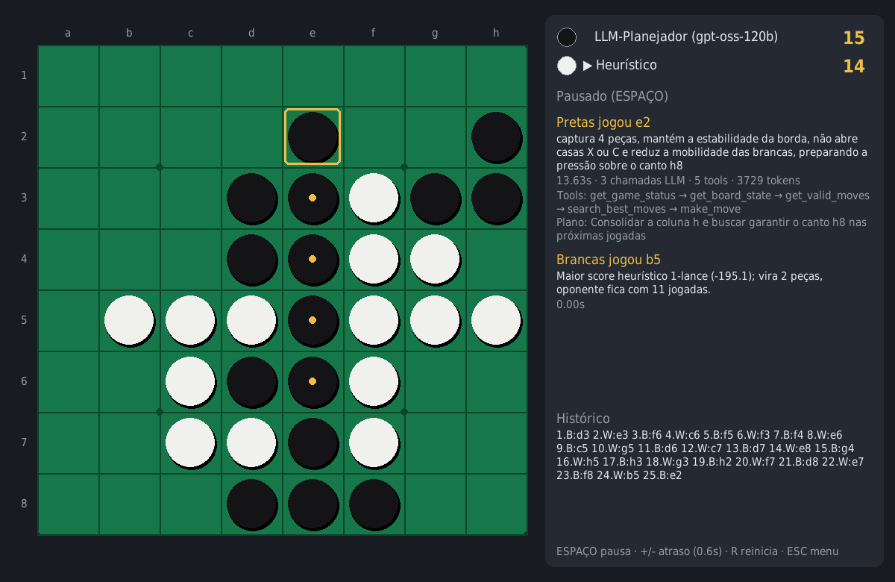

## 1. Introdução

Este trabalho implementa um **agente inteligente que joga Othello** (Reversi) com uma
LLM inserida num fluxo de decisão estruturado com **LangGraph**. A cada turno o agente
**percebe** o ambiente, **consulta ferramentas** (*tools*), **analisa** alternativas,
**decide**, **executa** a jogada no próprio ambiente e **registra** o que fez na memória.
O ciclo se repete até o fim da partida. A LLM não recebe o tabuleiro para simplesmente
devolver uma posição: ela escolhe quais ferramentas chamar, interpreta os resultados e
age por meio de `make_move`. Quando propõe uma jogada inválida, recebe o erro do
ambiente e corrige.

Para medir o papel de cada componente foram implementados cinco jogadores:

* **LLM Planejador**: o agente principal (seção 5.4);
* **LLM Básico**: laço ReAct com apenas as quatro ferramentas obrigatórias;
* **Minimax (d4)**: busca Alfa-Beta, sem LLM;
* **Heurístico**: avaliação gulosa de um lance, sem LLM;
* **Aleatório**: linha de base.

**Tecnologias.** Python 3.12, LangChain (`langchain-core` 1.8), LangGraph 1.2, Groq
(`openai/gpt-oss-120b` e `openai/gpt-oss-20b`, plano gratuito, via `langchain-groq`),
Pygame 2.6, pandas/matplotlib e pytest.

## 2. O ambiente: regras do Othello

O motor (`othello/game.py`) representa o tabuleiro com **bitboards**: cada cor é um
inteiro de 64 bits, e o bit `8·linha + coluna` indica uma peça. Para gerar as jogadas, o
conjunto de peças é deslocado nas 8 direções e acumula sequências de peças adversárias que
terminam numa casa vazia. Máscaras impedem que um deslocamento "dê a volta" entre as
colunas *a* e *h*. A mesma técnica calcula as peças invertidas por um lance. Por isso a
busca Minimax é rápida mesmo em Python: cerca de 0,02 s por lance com profundidade 4.

**Regras implementadas:**

* tabuleiro 8×8 com a posição inicial padrão;
* jogada válida somente se cercar ao menos uma linha de peças adversárias;
* inversão de todas as linhas cercadas;
* **passe obrigatório**, automático, quando o jogador da vez não tem jogada;
* **fim de jogo** quando nenhum dos dois pode jogar, com vencedor pela contagem de peças.

As coordenadas seguem a notação padrão (coluna *a–h*, linha *1–8*, ex.: `d3`), a mesma do
eOthello.

**Validação.** São 11 testes automatizados (`pytest`):

* capturas nas 8 direções e ausência de *wrap-around* nas bordas;
* passe automático e fim de jogo;
* **verificação cruzada com uma implementação ingênua** (matriz 8×8) em 300 partidas
  aleatórias completas, comparando lance a lance as jogadas válidas e as peças invertidas;
* o Alfa-Beta devolve exatamente o mesmo valor que um Minimax sem poda;
* a busca exata de final de jogo está correta.

## 3. Arquitetura

<figure>
<svg viewBox="0 0 760 270" xmlns="http://www.w3.org/2000/svg" font-family="DejaVu Sans, Arial" font-size="12">
<defs><marker id="a" viewBox="0 0 10 10" refX="9" refY="5" markerWidth="7" markerHeight="7" orient="auto"><path d="M0,0 L10,5 L0,10 z" fill="#52514e"/></marker></defs>
<g stroke="#52514e" stroke-width="1.3" fill="none" marker-end="url(#a)">
<path d="M150,55 L237,80"/><path d="M150,135 L237,112"/><path d="M150,215 L237,185"/>
<path d="M400,95 H475"/><path d="M400,175 H475"/>
<path d="M610,135 V90" /><path d="M640,135 V180"/>
</g>
<g fill="#f3f1ec" stroke="#b4b2ab">
<rect x="10" y="30" width="140" height="50" rx="8"/><rect x="10" y="110" width="140" height="50" rx="8"/><rect x="10" y="190" width="140" height="50" rx="8"/>
<rect x="240" y="60" width="160" height="70" rx="8" fill="#e3eefb" stroke="#2a78d6"/>
<rect x="240" y="150" width="160" height="60" rx="8"/>
<rect x="480" y="40" width="270" height="50" rx="8"/><rect x="480" y="110" width="270" height="50" rx="8" fill="#e3eefb" stroke="#2a78d6"/><rect x="480" y="180" width="270" height="50" rx="8"/>
</g>
<g fill="#0b0b0b" text-anchor="middle">
<text x="80" y="52" font-weight="bold">ui/ (Pygame)</text><text x="80" y="68" fill="#52514e">Humano×Agente, A×A</text>
<text x="80" y="132" font-weight="bold">experiments/</text><text x="80" y="148" fill="#52514e">experimentos, torneio</text>
<text x="80" y="212" font-weight="bold">main.py (CLI)</text><text x="80" y="228" fill="#52514e">partida no terminal</text>
<text x="320" y="85" font-weight="bold">players/</text><text x="320" y="101" fill="#52514e">interface Player</text><text x="320" y="117" fill="#52514e">play / choose_move</text>
<text x="320" y="175" font-weight="bold">othello/arena.py</text><text x="320" y="192" fill="#52514e">laço da partida</text>
<text x="615" y="62" font-weight="bold">agent/ (LangGraph)</text><text x="615" y="78" fill="#52514e">grafos básico e planejador, memória</text>
<text x="615" y="132" font-weight="bold">agent/tools.py</text><text x="615" y="148" fill="#52514e">7 ferramentas LangChain (&#64;tool)</text>
<text x="615" y="202" font-weight="bold">othello/ (ambiente)</text><text x="615" y="218" fill="#52514e">regras, heurística, Alfa-Beta</text>
</g>
</svg>
<figcaption>Figura 1 — Módulos do sistema. A UI, os experimentos e a CLI usam a mesma interface de jogador. Os agentes LLM agem sobre o ambiente exclusivamente através das ferramentas.</figcaption>
</figure>

Todos os jogadores implementam `players.base.Player`. Os jogadores clássicos só precisam
de `choose_move(game)`. Os agentes LLM sobrescrevem `play(game)`, porque **são eles que
executam a jogada** chamando a ferramenta `make_move` sobre o jogo real. Essa interface
única é usada pela interface gráfica, pelos experimentos, pelo torneio e pela CLI, e
permite plugar o agente de outro grupo no torneio com um adaptador simples.

## 4. Ferramentas

As ferramentas são funções Python decoradas com `@tool` (LangChain), criadas por
`build_tools(env)`. Elas operam sobre um objeto `GameEnv`, que guarda o jogo, a cor do
agente, a memória e os contadores de métricas.

| Ferramenta | Tipo | O que retorna / faz |
|---|---|---|
| `get_board_state()` | obrigatória | Tabuleiro em texto (`B`, `W`, `.` e `*` para jogadas válidas), orientação, vez e placar |
| `get_valid_moves()` | obrigatória | Jogadas válidas e quantas peças cada uma vira |
| `make_move(position, reasoning, plan)` | obrigatória | **Executa** a jogada; se for inválida, devolve o erro e a lista de jogadas válidas |
| `get_game_status()` | obrigatória | Em andamento ou encerrada, vez, placar, nº do lance, fase, vencedor |
| `evaluate_move(position)` | análise | Para uma candidata: peças viradas, canto/borda, casa X/C perigosa, se **entrega canto**, mobilidade resultante, score heurístico |
| `search_best_moves(k, depth)` | planejamento | *Top-k* jogadas segundo um Minimax Alfa-Beta (até profundidade 5) |
| `get_move_history(last_n)` | memória | Histórico da partida com as justificativas anteriores |

Toda chamada de ferramenta e de LLM é contabilizada: número de chamadas, latência,
tokens de entrada e saída, jogadas inválidas, fallbacks e erros de API. Esses números
alimentam os experimentos.

## 5. Estratégia e tomada de decisão

### 5.1 Função de avaliação heurística

`othello/heuristics.py` combina critérios clássicos, com pesos que variam conforme a fase
do jogo (abertura > 44 casas vazias; meio-jogo; final ≤ 14):

* **posicional**: matriz de pesos por casa. Cantos valem +100; casas X (b2, g2, b7, g7)
  e C (vizinhas dos cantos na borda) são negativas **enquanto o canto correspondente está
  vazio**;
* **mobilidade**: (minhas jogadas − jogadas do oponente) / total;
* **fronteira**: peças vizinhas de casas vazias (quanto menos, melhor);
* **cantos**: posse dos 4 cantos;
* **estabilidade**: peças ancoradas num canto ao longo das bordas, que não podem mais ser
  viradas;
* **paridade de peças**: só pesa no final.

### 5.2 Minimax com poda Alfa-Beta

`othello/search.py` implementa o Minimax na forma *negamax* com poda Alfa-Beta:

* as jogadas são ordenadas pelo peso posicional (cantos primeiro) para podar mais;
* passes são tratados explicitamente;
* posições terminais valem ±100 000 mais a diferença de peças;
* quando restam 10 casas vazias ou menos, a busca vai até o fim (**solução exata**).

`rank_moves` avalia todas as jogadas com janela completa e alimenta a ferramenta
`search_best_moves`.

### 5.3 Agente LLM Básico (ReAct)

É um grafo LangGraph simples, `agent ⇄ tools`, com apenas as quatro ferramentas
obrigatórias. A LLM recebe só o histórico de lances da partida e decide sozinha quando
observar e quando jogar. Se terminar sem jogar, um nó `nudge` a lembra de chamar
`make_move`. Após 6 chamadas sem jogada válida, entra o fallback: uma jogada aleatória,
contabilizada nas métricas. Esse agente responde à pergunta "a LLM sozinha, só com acesso
ao ambiente, joga bem?".

### 5.4 Agente LLM Planejador (grafo LangGraph)

<figure>
<svg viewBox="0 0 760 250" xmlns="http://www.w3.org/2000/svg" font-family="DejaVu Sans, Arial" font-size="12">
<defs><marker id="b" viewBox="0 0 10 10" refX="9" refY="5" markerWidth="7" markerHeight="7" orient="auto"><path d="M0,0 L10,5 L0,10 z" fill="#52514e"/></marker></defs>
<g stroke="#52514e" stroke-width="1.3" fill="none" marker-end="url(#b)">
<path d="M70,60 H103"/><path d="M193,60 H233"/>
<path d="M323,52 H393"/><path d="M393,72 H323" stroke-dasharray="4 3"/>
<path d="M483,60 H633"/>
<path d="M278,82 V150"/>
<path d="M323,175 H393"/><path d="M438,152 C 438,120 330,110 318,152" stroke-dasharray="4 3"/>
<path d="M483,175 H563"/>
<path d="M438,198 V220 H588 V198" />
<path d="M678,82 V110 H678" />
<path d="M608,152 L 650 84"/>
</g>
<g fill="#f3f1ec" stroke="#b4b2ab">
<rect x="10" y="40" width="60" height="40" rx="20"/>
<rect x="105" y="40" width="88" height="40" rx="8"/>
<rect x="235" y="40" width="88" height="40" rx="8" fill="#e3eefb" stroke="#2a78d6"/>
<rect x="395" y="40" width="88" height="40" rx="8"/>
<rect x="635" y="40" width="88" height="40" rx="8"/>
<rect x="235" y="152" width="88" height="45" rx="8" fill="#e3eefb" stroke="#2a78d6"/>
<rect x="395" y="152" width="88" height="45" rx="8"/>
<rect x="565" y="152" width="88" height="45" rx="8" fill="#fbe9e1" stroke="#eb6834"/>
</g>
<g fill="#0b0b0b" text-anchor="middle">
<text x="40" y="64">início</text>
<text x="149" y="58" font-weight="bold">observe</text><text x="149" y="72" fill="#52514e" font-size="9">3 tools + memória</text>
<text x="279" y="58" font-weight="bold">think</text><text x="279" y="72" fill="#52514e" font-size="9">LLM escolhe tools</text>
<text x="439" y="58" font-weight="bold">tools</text><text x="439" y="72" fill="#52514e" font-size="9">análise + make_move</text>
<text x="679" y="58" font-weight="bold">memorize</text><text x="679" y="72" fill="#52514e" font-size="9">plano/justif.</text>
<text x="279" y="172" font-weight="bold">decide</text><text x="279" y="186" fill="#52514e" font-size="9">make_move forçado</text>
<text x="439" y="172" font-weight="bold">execute</text><text x="439" y="186" fill="#52514e" font-size="9">valida no ambiente</text>
<text x="609" y="172" font-weight="bold">fallback</text><text x="609" y="186" fill="#52514e" font-size="9">Alfa-Beta</text>
<text x="560" y="52" fill="#52514e" font-size="9">jogou</text>
<text x="358" y="98" fill="#52514e" font-size="9">analisou / erro</text>
<text x="250" y="120" fill="#52514e" font-size="9">sem tool ou limite</text>
<text x="440" y="112" fill="#52514e" font-size="9">inválida</text>
<text x="515" y="236" fill="#52514e" font-size="9">esgotou tentativas</text>
</g>
</svg>
<figcaption>Figura 2 — Grafo do agente Planejador (<code>agent/graph.py</code>). Nós em azul chamam a LLM. Linhas tracejadas são laços de realimentação.</figcaption>
</figure>

O estado do grafo (`PlannerState`) guarda as mensagens do turno, os contadores de rodadas
e tentativas e a indicação de fallback. Os nós:

1. **observe (percepção):** chama `get_game_status`, `get_board_state` e
   `get_valid_moves` e monta a observação com a **memória**: lances da partida, as três
   últimas decisões do agente com suas justificativas, os últimos lances do oponente e
   o **plano anterior**.
2. **think (raciocínio):** a LLM recebe princípios estratégicos (cantos, casas X/C,
   mobilidade, jogadas silenciosas, estabilidade, contagem no final) e escolhe as
   ferramentas, normalmente `search_best_moves` e/ou `evaluate_move` em paralelo. Ela pode
   discordar da busca, desde que justifique. Em seguida chama
   `make_move(position, reasoning, plan)`.
3. **tools / execute (ação):** o `ToolNode` executa as ferramentas. Uma jogada inválida
   volta como mensagem de erro com as jogadas válidas, e a LLM corrige.
4. **decide (rede de segurança):** se a LLM responder sem chamar ferramenta ou estourar
   o limite de rodadas, este nó força `make_move` via `tool_choice`.
5. **fallback:** depois de falhas repetidas, usa a melhor jogada do Alfa-Beta e
   registra o evento.
6. **memorize (memória):** o plano declarado em `make_move` vira o "plano anterior" do
   turno seguinte. A justificativa fica gravada no histórico da partida, que também é
   consultável por `get_move_history`.

**Memória.** O histórico completo da partida (`MoveRecord`: lance, jogador, peças
viradas, placar, justificativa) fica no ambiente. A memória do agente acrescenta o plano
corrente. Para economizar tokens, cada turno começa com uma lista nova de mensagens, e a
memória entra como um **resumo compacto** em vez de repetir toda a conversa anterior.

**Explicabilidade.** Toda jogada dos agentes LLM vem acompanhada de uma justificativa em
português e de um plano. A interface mostra os dois em tempo real.

### 5.5 Engenharia de custo

No plano gratuito do Groq, cada modelo tem limite de **8 mil tokens por minuto** e um teto
diário. A primeira versão do Planejador gastava cerca de 4,2 mil tokens por lance, em 4
chamadas (analisar → responder → decidir → executar). Duas mudanças baixaram isso para
cerca de 3,1 mil tokens e 2,5 chamadas por lance:

* `make_move` passou a ficar disponível já no nó `think`;
* o nó `decide` virou apenas uma rede de segurança.

Também foram adicionados:

* um limitador de requisições compartilhado entre os agentes (`InMemoryRateLimiter`);
* novas tentativas com *backoff* para erros 429;
* `reasoning_effort=low` nos modelos gpt-oss;
* interrupção limpa do experimento quando a cota diária acaba. A partida incompleta é
  descartada e pode ser retomada com `--start`.

## 6. Interface e modos de jogo

A interface em **Pygame** (`ui/pygame_app.py`) tem um menu para escolher o jogador de cada
cor e atalhos para **Humano × Agente**, **Agente × Agente** e clássicos. Durante a
partida ela mostra:

* o tabuleiro, com as jogadas válidas do humano marcadas, o último lance destacado e as
  peças viradas indicadas;
* o placar e de quem é a vez, com um aviso "pensando…" e o tempo decorrido;
* para cada lado: a jogada, a **justificativa**, o **plano**, as ferramentas chamadas, o
  tempo, o nº de chamadas à LLM e os tokens;
* o histórico de lances.

Os agentes rodam numa *thread* separada, para a janela não travar enquanto a LLM pensa.
Controles: ESPAÇO pausa, `+`/`-` ajustam o atraso entre lances, R reinicia, ESC volta ao
menu. Também há um modo texto (`python main.py --cli`).

<figure><figcaption>Figura 3 — Interface no lance 25 da partida LLM Planejador (pretas) × Heurístico, reproduzindo dados registrados no experimento. O painel mostra a justificativa, o plano, as ferramentas chamadas e o custo do lance. A menção ao canto h8 (distante de e2) é um exemplo do erro de orientação espacial discutido na seção 8.</figcaption></figure>

## 7. Experimentos

**Metodologia:**

* cada confronto alterna as cores: as partidas 2k e 2k+1 usam **a mesma abertura**
  sorteada (4 lances aleatórios), com as cores trocadas. Isso diversifica as partidas
  (sem a abertura, dois jogadores determinísticos repetiriam o mesmo jogo) e anula a
  vantagem de começar;
* os resultados são gravados lance a lance em `results/turns.csv` e por partida em
  `results/games.csv`;
* a análise (`experiments/analyze.py`) gera as tabelas e os gráficos.

**Limitação de orçamento.** Os agentes LLM usam o plano gratuito do Groq. Uma partida do
Planejador consome cerca de 90 mil tokens e leva ~8 min (o limite de 8 mil tokens por
minuto domina o tempo). Por isso:

* os confrontos sem LLM têm 50 partidas cada;
* os confrontos com LLM têm poucas partidas (indicado em cada tabela);
* a comparação direta Básico × Planejador usou `gpt-oss-20b`, que tem cota própria, com
  o **mesmo modelo nos dois lados** para a comparação ser justa;
* as partidas contra o Heurístico usaram `gpt-oss-120b`.

{{RESULTADOS}}

## 9. Dificuldades encontradas e como foram tratadas

| # | Dificuldade | Impacto | Como foi tratada |
|-|--------------|-----------|----------------|
| 1 | O modelo planejado inicialmente (`llama-3.3-70b-versatile`) foi **descontinuado** pelo Groq | Troca de modelo no meio do desenvolvimento | Adoção do `openai/gpt-oss-120b`, com o modelo configurável por `.env`/`--model` e `reasoning_effort=low` para conter os tokens de raciocínio |
| 2 | **Limites do plano gratuito**: 8 mil tokens/min, 1 000 requisições/dia e **200 mil tokens/dia por modelo** (confirmado pela própria mensagem de erro 429 da API) | Uma partida do Planejador (~90 mil tokens) consome quase metade da cota diária, e o limite por minuto força ~15–27 s por lance | Otimização do grafo (de 4,2 mil para 3,1 mil tokens e de 4 para 2,5 chamadas por lance), limitador de requisições compartilhado e novas tentativas com *backoff* |
| 3 | **Cota diária esgotada no meio de um experimento** | Partidas incompletas ou decididas por fallback contaminariam os resultados | Detecção do erro de cota diária (`DailyLimitError`): a partida em andamento é descartada e o experimento para, indicando como retomar (`--start N`) |
| 4 | **Prazo de entrega no mesmo dia** dos experimentos | Não foi possível espalhar as partidas por vários dias | Execução em paralelo em dois modelos com cotas independentes (120b e 20b), com o mesmo modelo nos dois lados no confronto direto. Análise por lance (dezenas de observações por agente) e amostra pequena declarada explicitamente |
| 5 | **Chamadas de ferramenta malformadas** no `gpt-oss-20b` (nome <code>make_move&lt;&#124;channel&#124;&gt;commentary</code>, erro 400 `tool_use_failed`) | Na primeira tentativa o Básico caiu no fallback aleatório, o que distorceria a comparação | Execução interrompida e descartada. A chamada passou a ser repetida automaticamente (até 3 vezes), e não houve nenhum fallback depois disso |
| 6 | **Erros de orientação espacial da LLM** ("borda inferior" para a linha 1; cantos citados sem relação com a casa jogada) | Justificativas erradas e risco de decisões ruins | Legenda explícita no tabuleiro (linha 1 = borda de cima) e relações geométricas calculadas por `evaluate_move`. O problema foi **reduzido, mas não eliminado** |
| 7 | **Justificativas nem sempre fiéis** à jogada (ex.: "maximiza mobilidade do oponente") | A explicação pode enganar quem acompanha a partida | Registrado como limitação; métricas objetivas por lance (concordância com a busca, casas X, cantos entregues) complementam as justificativas |
| 8 | **Cotas do 120b e do 20b esgotadas** antes da gravação do vídeo | As partidas com LLM não rodariam na demonstração | No vídeo, os agentes LLM usam o `qwen/qwen3.8-27b` (cota própria), validado antes num lance de cada agente. **Os resultados deste relatório são apenas dos modelos gpt-oss.** |
| 9 | Jogadores determinísticos **repetiam a mesma partida** | Experimentos clássicos sem variação | Aberturas aleatórias (4 lances) com cores alternadas na mesma abertura |
| 10 | **Escala desbalanceada na heurística** (o termo de estabilidade dominava, com scores de cerca de −1900) | Avaliações distorcidas | Estabilidade passou a ser a diferença absoluta de peças estáveis, revalidada com os confrontos clássicos |
| 11 | **Interface travada** enquanto a LLM pensa (10–30 s) | Janela sem resposta | Agentes executados numa *thread* separada, com indicador "pensando…" e tempo decorrido |

## 10. Limitações

* **Amostra pequena nos confrontos com LLM**, por causa da cota gratuita da API. As taxas
  de vitória desses confrontos são indicativas, não estatisticamente conclusivas.
* **O Planejador depende das ferramentas para ser forte.** Grande parte da qualidade vem
  da busca Alfa-Beta exposta como ferramenta. A contribuição da LLM é escolher as
  ferramentas, combinar critérios, explicar e, às vezes, divergir da busca.
* **Raciocínio espacial da LLM.** A LLM confunde "borda de cima" com "borda de baixo" e
  cita cantos que não têm relação com a casa jogada. A legenda explícita de orientação
  **reduziu, mas não eliminou** o problema (seção 8.6). Por isso as relações geométricas
  que importam para a decisão (casa X/C, canto entregue) são calculadas por `evaluate_move`.
* **Justificativas nem sempre fiéis.** A explicação em linguagem natural pode contradizer a
  própria jogada. Ela é útil para acompanhar o agente, mas não deve ser lida como
  rastreamento exato do raciocínio.
* **Latência e custo.** 10–20 s por lance contra milissegundos do Minimax, o que torna a
  LLM inviável como "motor de busca". O valor dela está na orquestração e na explicação.
* **Heurística com pesos ajustados à mão**, sem otimização automática (por exemplo,
  *self-play*).

## 11. Conclusão

{{CONCLUSAO}}

## Apêndice — Como executar

```bash
pip install -r requirements.txt && cp .env.example .env   # colocar GROQ_API_KEY
python main.py                                               # interface gráfica
python main.py --black humano --white llm-planejador --start
python -m experiments.run_experiments --pair llm-basico:llm-planejador --games 4
python -m experiments.tournament --players aleatorio heuristico minimax
python -m experiments.analyze
pytest -q
```
