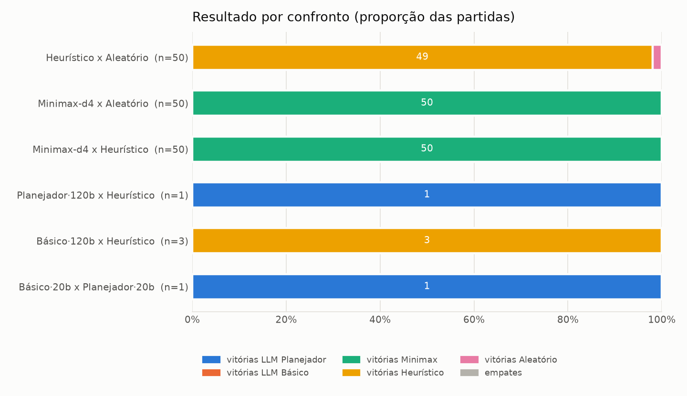
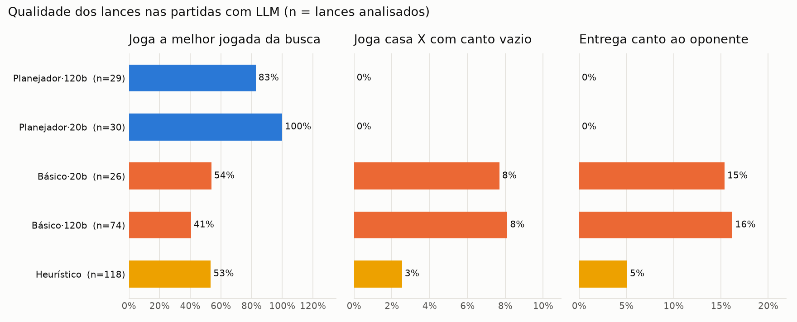
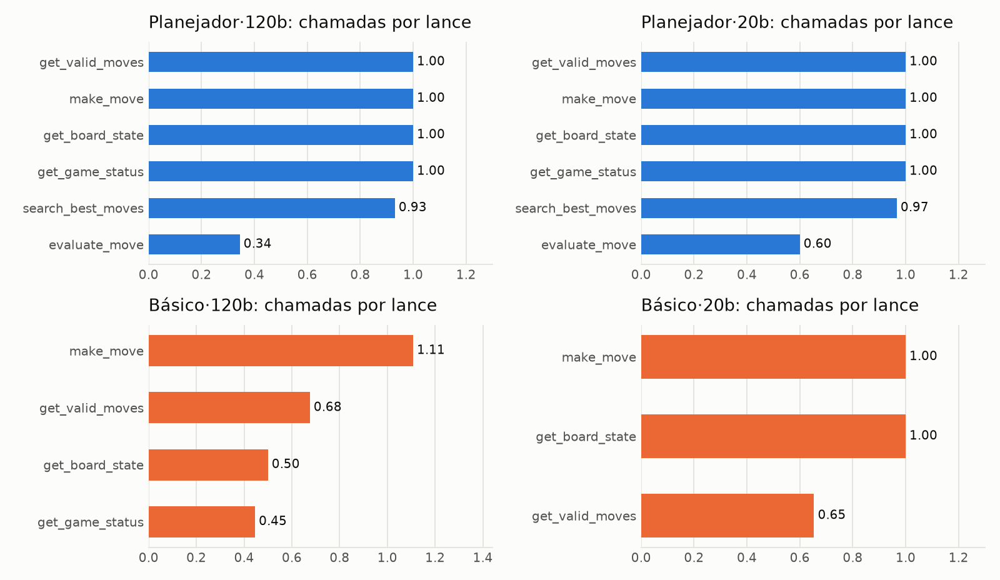
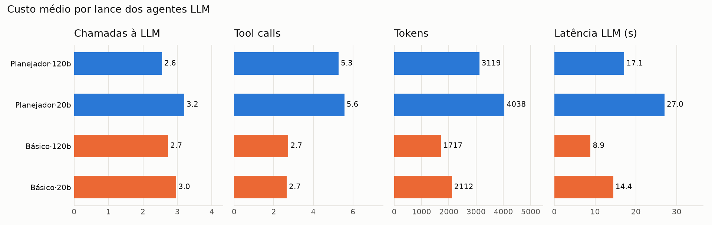

## 8. Resultados e análise

### 8.1 Linhas de base (sem LLM)

| Confronto | Partidas | Resultado | Saldo médio de peças | Tempo médio/partida |
|---|---|---|---|---|
| Heurístico × Aleatório | 50 | 49 V / 0 E / 1 D (98%) | +38,2 | 0,02 s |
| Minimax-d4 × Aleatório | 50 | 50 V (100%) | +50,7 | 0,51 s |
| Minimax-d4 × Heurístico | 50 | 50 V (100%) | +48,3 | 0,60 s |

No **torneio** todos-contra-todos (5 aberturas × 2 cores por confronto; vitória 3, empate 1,
derrota 0), o resultado foi: **Minimax 60 pts** (20 V, saldo +1012), Heurístico 24 pts (8 V,
saldo −200) e Aleatório 6 pts (2 V, saldo −812). A hierarquia esperada se confirma, e ela
valida a heurística e a busca que o agente Planejador usa como ferramentas.

### 8.2 Agentes LLM: resultados das partidas

| Confronto | Modelo | Partidas | Resultado (placares) |
|---|---|---|---|
| LLM Planejador × Heurístico | gpt-oss-120b | 1 | **Planejador venceu** (45 × 19) |
| LLM Básico × Heurístico | gpt-oss-120b | 3 | **Básico perdeu as 3** (1 × 62, 24 × 40, 5 × 57; saldo médio −43) |
| LLM Básico × LLM Planejador | gpt-oss-20b | 1 | **Planejador venceu** (59 × 5) |

<figure><figcaption>Figura 4 — Resultado por confronto. Nos confrontos com LLM o número de partidas é pequeno (cota gratuita da API).</figcaption></figure>

Com tão poucas partidas não é possível estimar taxas de vitória com confiança. Mesmo assim,
a direção e o tamanho das diferenças são consistentes:

* o **Básico perdeu todas** as partidas para o Heurístico, um adversário de 1 lance de
  profundidade;
* o **Planejador venceu todas**, inclusive o Básico com o mesmo modelo por 59 × 5.

Por isso a análise a seguir usa o **lance** como unidade, o que dá dezenas de observações
por agente.

### 8.3 Qualidade dos lances

Cada partida com LLM foi reproduzida, e cada lance (após a abertura sorteada) foi comparado
com o ranking do Alfa-Beta de profundidade 4, com final exato.

| Agente | Lances | Joga o top-1 da busca | Rank médio | Canto tomado quando disponível | Casa X com canto vazio | Entrega canto |
|---|---|---|---|---|---|---|
| Planejador · 120b | 29 | **83%** | 1,31 | 4/4 | 0% | 0% |
| Planejador · 20b | 30 | **100%** | 1,00 | 4/4 | 0% | 0% |
| Heurístico | 118 | 53% | 2,22 | 11/12 | 3% | 5% |
| Básico · 20b | 26 | 54% | 2,35 | — (0 ocasiões) | 8% | 15% |
| Básico · 120b | 74 | **41%** | 2,93 | 1/2 | **8%** | **16%** |

<figure><figcaption>Figura 5 — Qualidade dos lances nas partidas com LLM (n = lances analisados).</figcaption></figure>

O LLM Básico joga como um iniciante. Em 16% dos lances ele **entrega um canto** ao
oponente e em 8% joga numa **casa X** com o canto vazio, os dois erros mais conhecidos
do Othello. O Planejador, com as ferramentas de análise, não cometeu nenhum dos dois.

### 8.4 O que a LLM faz quando discorda da busca?

Esta análise isola a contribuição da LLM no Planejador. Nos lances em que ela **não**
seguiu o top-1 do Alfa-Beta, medimos a perda de score em relação à melhor jogada.

| Agente | Divergências | Perda mediana | Quase equivalentes (perda < 15) | Graves (perda ≥ 100) |
|---|---|---|---|---|
| Planejador · 120b | 5/29 (17%) | 40 | 2 | 2 |
| Planejador · 20b | 0/30 (0%) | — | — | — |
| Heurístico | 55/118 (47%) | 28 | 18 | 12 |
| Básico · 20b | 12/26 (46%) | 80 | 2 | 5 |
| Básico · 120b | 44/74 (59%) | 85 | 4 | 16 |

Exemplos de divergências do Planejador · 120b:

* lance 29: **e1** em vez de g8 (perda 5): "Jogada segura na borda inferior, captura 1 peça,
  não abre casas X/C…". A escolha é defensável e quase equivalente, mas e1 fica na borda
  **superior**. Esta partida foi jogada antes da correção da legenda de orientação;
* lance 31: **a5** em vez de g8 (perda 108): "Jogada na borda segura, captura 3 peças…";
* lance 49 (final): **g6** em vez de b1 (perda 503): "G6 vira 9 peças, aumenta vantagem…".
  Aqui a LLM cedeu à **gula por peças**, que o próprio prompt desaconselhava.

**Leitura.** O modelo maior "pensa por conta própria" em 17% dos lances. Em parte desses
casos a divergência é inofensiva, mas a mediana é negativa e há duas divergências graves.
O modelo menor delegou integralmente à busca. Nos dois casos, **a força do Planejador vem
da ferramenta de planejamento**. A contribuição da LLM é orquestrar, ou seja, decidir o
que consultar e combinar as análises, e explicar as decisões. Divergir da busca, em média,
não acrescentou força.

### 8.5 Uso de ferramentas e custo

| Agente | Chamadas LLM/lance | Tool calls/lance | Tokens/lance | Latência/lance | Jogadas inválidas | Fallbacks |
|---|---|---|---|---|---|---|
| Planejador · 120b | 2,55 | 5,28 | 3 119 | 17,3 s | 0 | 0 |
| Planejador · 20b | 3,20 | 5,57 | 4 038 | 27,1 s | 0 | 0 |
| Básico · 120b | 2,73 | 2,73 | 1 717 | 8,9 s | 8 (todas corrigidas) | 0 |
| Básico · 20b | 2,96 | 2,65 | 2 112 | 14,5 s | 0 | 0 |
| Minimax-d4 | — | — | — | 0,02 s | — | — |

<figure><figcaption>Figura 6 — Ferramentas chamadas por lance. No Planejador, get_game_status, get_board_state e get_valid_moves são chamadas pelo nó <em>observe</em>; search_best_moves e evaluate_move são escolhidas pela LLM.</figcaption></figure>

<figure><figcaption>Figura 7 — Custo médio por lance dos agentes LLM.</figcaption></figure>

* **Hábitos de observação do Básico.** Livre para escolher, o Básico · 120b consultou
  `get_valid_moves` em só 68% dos lances e `get_board_state` em só 50%. Em vários turnos ele
  jogou "às cegas", a partir do histórico. Isso explica as 8 tentativas de jogada inválida.
  Todas foram corrigidas pelo **feedback do ambiente**: o erro de `make_move` traz a lista de
  jogadas válidas.
* **O Planejador escolheu bem as ferramentas.** Usou `search_best_moves` em 93–97% dos
  lances e `evaluate_move` em 34–60%. Nunca usou `get_move_history`, porque a memória já
  chega resumida na observação.
* **Custo.** O Planejador gasta cerca de 2× mais tokens que o Básico e é três ordens de
  grandeza mais lento que o Minimax puro. Uma partida do Planejador consome ~90 mil tokens
  (120b), quase metade da cota diária gratuita.
* **Robustez.** O gpt-oss-20b gerou chamadas malformadas (nome de ferramenta corrompido,
  erro 400 `tool_use_failed`). A repetição automática da chamada resolveu todos os casos, e
  não houve **nenhum fallback** em todas as partidas com LLM.

### 8.6 Análise qualitativa das justificativas

* **Boas explicações, alinhadas à estratégia:** "Captura canto a8, reduz mobilidade do
  oponente e mantém estabilidade" (Planejador · 20b). "c5 vira apenas 1 peça, evita casas
  X/C e não entrega cantos; mantém mobilidade razoável na abertura" (Planejador · 120b).
* **Erros típicos do Básico:** "captura duas peças e aproxima um canto" ao jogar **b2**
  (casa X, entrega o canto a1; perda 250). "Ganha 2 peças e fortalece a coluna g" ao jogar
  **g2** (casa X; perda 244). O raciocínio é guloso e local, sem visão do que o oponente
  pode responder.
* **A explicação nem sempre é fiel à decisão:** "b6 maximiza mobilidade **do oponente**"
  (Planejador · 20b). A jogada era a melhor da busca, mas a justificativa descreve o
  contrário do objetivo. As justificativas ajudam a entender o agente, mas não são uma prova
  do raciocínio.
* **Orientação espacial:** mesmo com a legenda explícita, o 20b ainda descreveu d6 como
  "borda superior". Planos como "buscar captura de h8" aparecem em lances sem relação com
  esse canto. Por isso as relações geométricas (casa X/C, canto entregue) foram calculadas
  por `evaluate_move` em vez de deixadas para a LLM.
* **Memória e plano:** o Planejador mantém planos coerentes entre turnos, como "Manter
  bordas estáveis e buscar controle de colunas". O plano de um turno aparece como "plano
  anterior" no seguinte.
